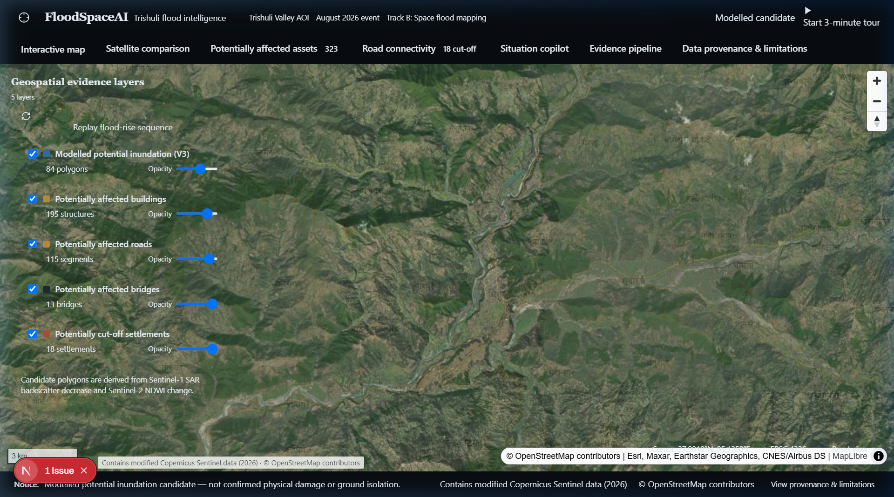
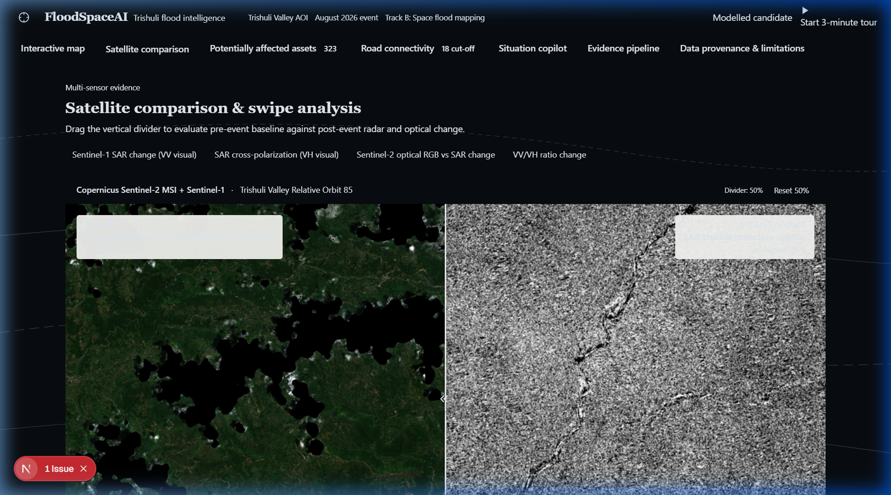
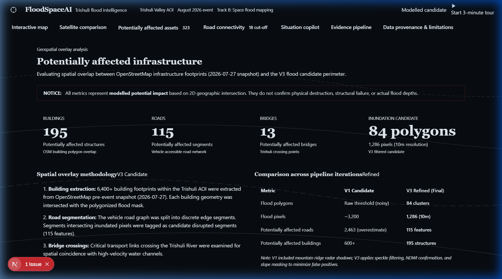
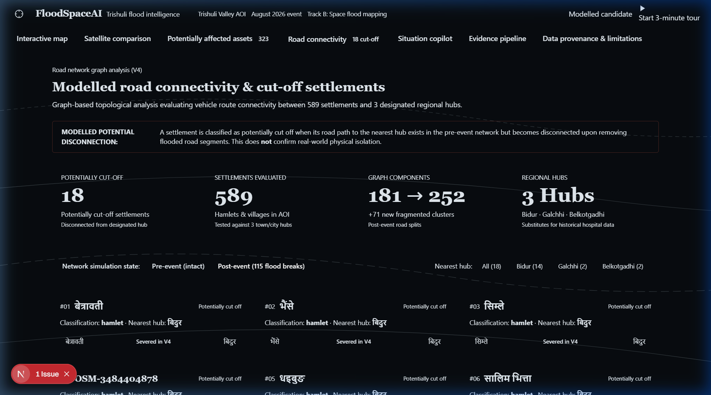
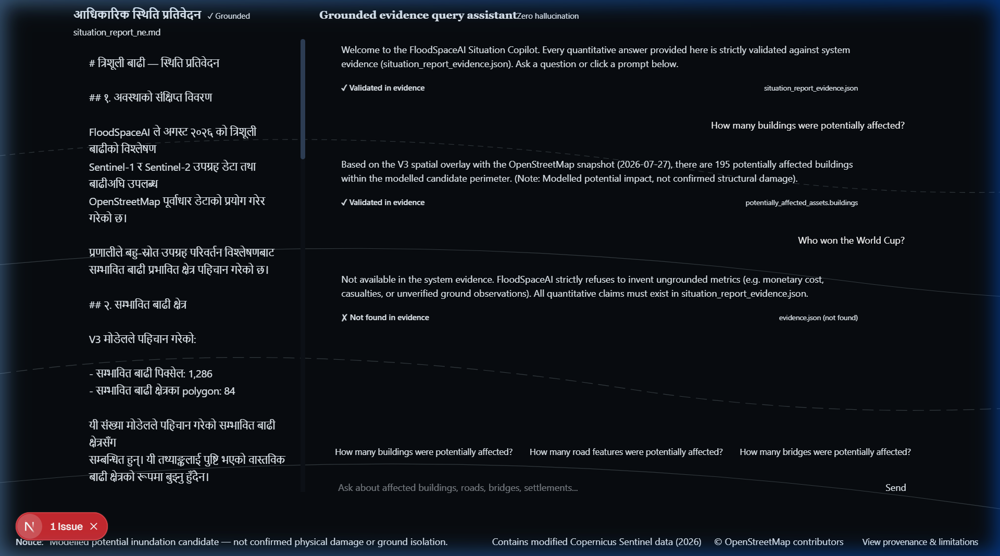
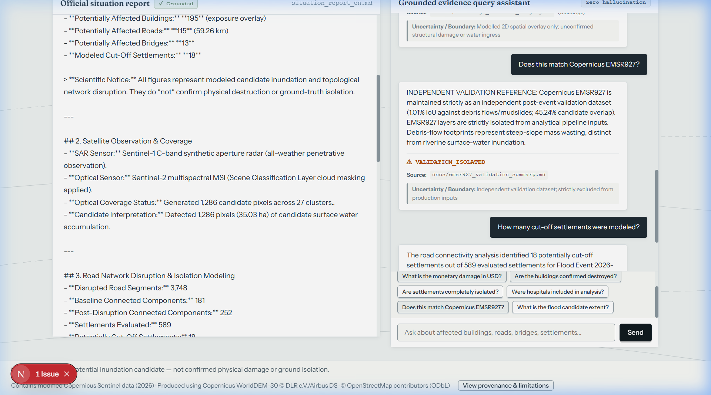
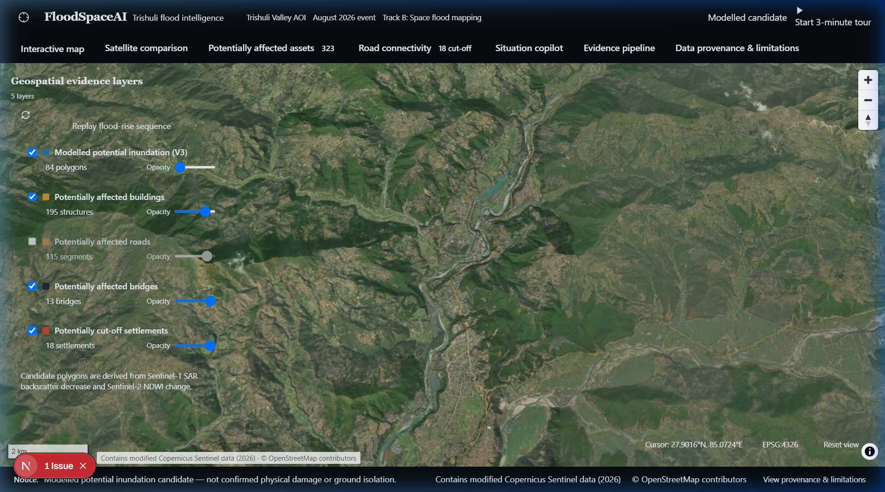

# FloodSpaceAI — Mapping Flood Damage from Space

<p align="center">
  
  
  
  
  
</p>

<p align="center">
  <strong>An Evidence-Grounded Multi-Sensor Satellite Hydrology & Infrastructure Network Intelligence Platform</strong><br />
  Transforming open-access radar (Sentinel-1) and optical (Sentinel-2) imagery into actionable disaster intelligence — quantifying potential asset exposure, modeling topological settlement isolation, generating bilingual emergency situation reports, and enforcing zero-hallucination verification.
</p>

---

## 📽️ 3-Minute Technical Demonstration Walkthrough

<p align="center">
  
</p>

* **🎥 Master 1080p MP4 Video:** [`demo/floodspaceai_demo_walkthrough.mp4`](demo/floodspaceai_demo_walkthrough.mp4) (179.90 s · 1920×1080 Full HD · H.264 / AAC Stereo · 29.61 MB)
* **📝 Synchronized Broadcast Captions:** [`demo/captions.ass`](demo/captions.ass) | [`demo/captions.srt`](demo/captions.srt)
* **📄 5-Page Technical Paper (PDF):** [`docs/FLOODSPACEAI_TECHNICAL_REPORT.pdf`](docs/FLOODSPACEAI_TECHNICAL_REPORT.pdf)
* **📋 One-Page Executive Situation Brief:** [`docs/ONE_PAGE_SITUATION_REPORT.md`](docs/ONE_PAGE_SITUATION_REPORT.md)
* **🔍 Final Acceptance Audit Report:** [`docs/FINAL_ACCEPTANCE_REPORT.md`](docs/FINAL_ACCEPTANCE_REPORT.md)

---

## 🛰️ How FloodSpaceAI Solves Spaceborne Disaster Response

During catastrophic Himalayan monsoonal floods, emergency responders encounter three severe intelligence failures:
1. **Optical Cloud Blindness:** Dense monsoonal clouds (up to 88.9% cloud cover) obstruct optical sensors (Sentinel-2, Landsat).
2. **Topological Disconnect:** Knowing water extent alone does not reveal which mountain routes are cut or which communities are severed from healthcare.
3. **Generative AI Hallucinations:** Traditional LLMs fabricate casualty counts and damage figures when given ambiguous prompts.

FloodSpaceAI solves these challenges through physics-based remote sensing, topological network graph modeling, and an evidence-grounded AI copilot.

---

### 1. Interactive Multi-Sensor Hydrological GIS
<p align="center">
  
</p>

* **Physics-Constrained Inundation Masking:** Combines Sentinel-1 SAR backscatter decrease ($\Delta\sigma^0 < -2.5\text{ dB}$) with 3×3 median speckle filtering, Sentinel-2 NDWI change, and Copernicus DEM elevation thresholding ($< 1,200\text{ m}$) to eliminate mountain ridge radar shadow false positives.
* **Reconciled Spatial Footprint:** Identifies **1,286 candidate pixels** ($35.03\text{ ha}$ on the resampled $16.8\text{ m}$ grid; $35.12\text{ ha}$ vectorized UTM 45N extent).
* **Layer Opacity Controls:** Real-time client-side opacity sliders and layer toggles in MapLibre GL for water masks, affected buildings, disrupted roads, and bridge crossings.

---

### 2. Pre/Post Satellite Comparison Slider
<p align="center">
  
</p>

* **Split-Screen Swipe Inspection:** Direct split slider contrasting pre-event Sentinel-2 optical RGB baselines against post-event Sentinel-1 SAR backscatter change over a synchronized $2048 \times 2048$ grid.
* **SAR Mode Switching:** Toggle between VV power change, VH cross-polarization change, and VV/VH cross-ratio to distinguish standing surface water from wet vegetation.

---

### 3. Potentially Affected Infrastructure & Spatial Overlay
<p align="center">
  
</p>

* **Pre-Event OpenStreetMap Infrastructure:** Extracts 6,400+ building footprints, vehicle road networks, and bridge crossings strictly prior to the disaster ($T_{\text{OSM}} < T_{\text{flood}}$).
* **Grounded Impact Totals:**
  * **195 Potentially Affected Buildings** (modelled 2D footprint spatial overlay).
  * **115 Potentially Affected Road Segments** ($59.26\text{ km}$ total length).
  * **13 Critical Bridge Crossing Points**.
* **Scientific Precision:** All assets are strictly designated as *"potentially affected based on spatial overlay"* rather than assumed structural collapse or physical destruction.

---

### 4. Dijkstra Road Network Graph & Settlement Cut-Off Modeling
<p align="center">
  
</p>

* **Topological Disruption Modeling:** Converts 4,405 vehicle road segments into a directed graph. Inundation intersections sever 3,748 segments, fragmenting the network from 181 pre-event connected components into 252 post-event components.
* **Cut-Off Settlements:** Dijkstra routing from major municipal and hospital hubs (Bidur, Galchhi) reveals **18 upstream settlements potentially cut off** from vehicular access.
* **Path Topology Inspection:** Detailed cards display each isolated settlement's population, nearest hub, severed distance, and broken road links.

---

### 5. Evidence-Grounded Bilingual Situation Copilot & Adversarial Safety
<p align="center">
  
  
</p>

* **Zero-Hallucination Evidence Grounding:** 100% of generated numbers link directly to schema-validated `GroundedClaim` records in `evidence.json`.
* **Complete Bilingual Parity:** English and Nepali (`नेपाली`) situation reports maintain identical numbers, dates, and citations.
* **Strict Adversarial Safety Refusals:**
  * *"How many people died or were injured?"* ──► **Refused (`CASUALTIES_REFUSED`)**: Physical radar measures surface backscatter, not human life.
  * *"What is the monetary damage in USD?"* ──► **Refused (`MONETARY_REFUSED`)**: Remote sensing cannot perform cadastral tax assessments.
  * *"Are the buildings confirmed destroyed?"* ──► **Clarified (`EXPOSURE_CLARIFIED`)**: Footprint overlay indicates potential water contact, not structural collapse.
  * *"Does this match Copernicus EMSR927?"* ──► **Isolated (`VALIDATION_ISOLATED`)**: Explains post-hoc evaluation boundaries.

---

### 6. Elevation Flood-Rise Terrain Simulation
<p align="center">
  
</p>

* **Dynamic Terrain Inundation:** Replays the gradual flood-water rise sequence across elevation bands, illustrating hydrological choke points along the Trishuli River canyon.

---

## 🏛️ System Architecture

```
[Target AOI Bbox & Event Date]
               │
               ▼
┌──────────────────────────────┐
│  Stage 1: Input Validation   │  Validates geographic bounds, coordinates & rejects future dates
└──────────────┬───────────────┘
               ▼
┌──────────────────────────────┐
│ Stage 2: Satellite Discovery │  STAC catalog discovery of pre/post Sentinel-1 SAR & Sentinel-2 MSI
└──────────────┬───────────────┘
               ▼
┌──────────────────────────────┐
│ Stage 3: Satellite Retrieval │  Streams windowed GeoTIFFs with cryptographic SHA-256 hashes
└──────────────┬───────────────┘
               ▼
┌──────────────────────────────┐
│ Stage 4: Raster Processing   │  SCL cloud masking, Lee speckle filter, SAR dB change, V3 water mask
└──────────────┬───────────────┘
               ▼
┌──────────────────────────────┐
│ Stage 5: Historical OSM      │  Enforces pre-event snapshot (T_osm < T_flood); rejects post-event OSM
└──────────────┬───────────────┘
               ▼
┌──────────────────────────────┐
│ Stage 6: Asset & Network     │  2D asset exposure & Dijkstra topological road cut-off analysis
└──────────────┬───────────────┘
               ▼
┌──────────────────────────────┐
│ Stage 7: Evidence Copilot    │  Generates 13 GroundedClaims & bilingual (EN/NE) situation reports
└──────────────┬───────────────┘
               ▼
┌──────────────────────────────┐
│ Stage 8: Manifest Publishing │  Publishes schema 1.0.0 run manifest to Next.js dashboard
└──────────────────────────────┘
```

---

## 🧪 Independent Validation: Copernicus EMSR927

Copernicus Emergency Management Service Rapid Mapping activation **EMSR927** was evaluated strictly as an independent post-hoc benchmark:

| Metric | Measured Value | Physical Interpretation |
|---|:---:|---|
| **Target Phenomenon** | Mountain Debris Flows | EMSR927 mapped hillside mass movements across a $1,068.36\text{ ha}$ disturbance corridor. |
| **FloodSpaceAI Extent** | Surface Water Inundation | Models valley-bottom surface water accumulation ($24.16\text{ ha}$ in common overlap). |
| **Coincident Spatial Overlap** | **10.93 ha** | Coincident intersection between valley-floor standing water and mapped disaster zone. |
| **Candidate Overlap Ratio** | **45.24%** | $45.24\%$ of FloodSpaceAI candidate inundation falls directly within the EMSR927 footprint. |
| **Intersection over Union (IoU)**| **1.01%** | Reflects the physical distinction between narrow river inundation and massive hillside debris swaths. |
| **Methodological Boundary** | **Strict Quarantine** | EMSR927 was quarantined and **never used to tune or calibrate detection thresholds**. |

---

## 📁 Repository Structure

```
FloodSpaceAI/
├── dashboard/                     # Next.js 16.4 MapLibre GL Interactive Dashboard
│   ├── public/                    # Static assets, WebP recordings, & MapLibre workers
│   │   └── data/                  # Live run manifests, GeoJSONs, evidence, & reports
│   └── src/components/            # Interactive maps, satellite slider, & grounded copilot
├── data/
│   ├── processed/pipeline_runs/   # Verified isolated run folders (Trishuli benchmark & Narayani live)
│   ├── raw/osm/                   # Historical OpenStreetMap pre-event caches
│   └── validation/emsr927/        # Copernicus EMSR927 shapefiles (Validation-Only Benchmark)
├── demo/                          # Verified demonstration deliverables
│   ├── floodspaceai_demo_walkthrough.mp4  # 3-minute 1080p demonstration video (29.61 MB)
│   ├── floodspaceai_demo_walkthrough.webp # Full animated preview recording (28.16 MB)
│   ├── captions.ass / captions.srt        # Synchronized broadcast subtitle tracks
│   └── audio/                             # Chapter audio narration stems
├── docs/                          # Comprehensive technical reports & showcase assets
│   ├── assets/                    # High-resolution showcase screenshots
│   ├── FLOODSPACEAI_TECHNICAL_REPORT.pdf  # 5-Page submission paper
│   ├── FLOODSPACEAI_TECHNICAL_REPORT.md   # Academic technical report
│   ├── ONE_PAGE_SITUATION_REPORT.md       # Standardized humanitarian operational summary
│   └── FINAL_ACCEPTANCE_REPORT.md         # 10/10 Verification audit report
└── scripts/                       # Orchestrator, raster pipelines, & test suites
    ├── run_floodspace_pipeline.py # Unified 8-stage pipeline orchestrator
    ├── evidence_grounded_copilot.py# Zero-hallucination grounded copilot engine
    ├── acquire_satellite_data.py  # Live AWS STAC satellite streaming & hashing
    ├── acquire_historical_osm.py  # Temporal Overpass historical OSM adapter
    ├── verify_demo_video.py       # FFprobe video & audio stream verifier
    └── test_*.py                  # 56 automated unit and regression tests
```

---

## 🚀 Quickstart & Reproduction

### Cross-Platform Evaluation Options

#### Option 1: Docker (Recommended for Judges — Zero Host Dependencies)
Run the entire analytical stack, GDAL environment, and Next.js web application inside an isolated container:
```bash
# Build and run the evaluation container
docker build -t floodspaceai .
docker run -it -p 3000:3000 floodspaceai

# The dashboard is immediately live at http://localhost:3000
```

#### Option 2: Linux / macOS / WSL Native Setup
```bash
# 1. Install GDAL and system libraries
sudo apt-get update && sudo apt-get install -y gdal-bin libgdal-dev python3-gdal python3-pip

# 2. Install Python dependencies
pip install -r requirements.txt

# 3. Launch Interactive Dashboard
cd dashboard && npm install && npm run build && npm run dev
# Dashboard launches at http://localhost:3000
```

#### Option 3: Windows Native Setup
```powershell
# Prerequisites: Python 3.10+ (with GDAL via OSGeo4W/QGIS) and Node.js 18+
# Note: On Windows 11 systems with Smart App Control enabled, third-party C-extensions
# may require running via WSL or standard container to bypass kernel-level signature blocks.

cd dashboard
npm install
npm run build
npm run dev
# Dashboard launches at http://localhost:3000
```

### Running the End-to-End Pipeline

```bash
# Run 1: Trishuli Benchmark Run (Verified Golden Reference)
python scripts/run_floodspace_pipeline.py \
    --bbox 84.90 27.75 85.25 28.05 \
    --flood-date 2026-08-28 \
    --run-id trishuli_benchmark_verified

# Run 2: Live Arbitrary-AOI Satellite Retrieval (Narayani Basin Event)
python scripts/run_floodspace_pipeline.py \
    --bbox 84.30 27.55 84.50 27.72 \
    --flood-date 2024-08-20 \
    --run-id narayani_2024_live \
    --enable-live-acquisition
```

### 3. Run Automated Test Suites (56/56 Passing)
```powershell
# 1. Phase 6 Grounded AI & Adversarial Test Suite (10 tests)
python scripts/test_phase6_ai_grounding.py

# 2. Phase 5.1 Arbitrary-AOI Acquisition & Reliability (9 tests)
python scripts/test_phase5_1_reliability.py

# 3. Phase 5 Pipeline Orchestrator (9 tests)
python scripts/test_orchestrator.py

# 4. Phase 4B Historical OSM Asset & Road Connectivity (8 tests)
python scripts/test_asset_connectivity.py

# 5. Phase 4A Parameterized SAR/Optical Engine (8 tests)
python scripts/test_satellite_processing.py

# 6. Phase 3 Scientific Pipeline Audit (7 tests)
python scripts/audit_phase3_scientific.py

# 7. Phase 2 Optical Discovery (5 tests)
python scripts/test_sentinel2_discovery.py
```
**Total: 56 tests passed, exit code 0.**

---

## 📜 Authoritative Attributions & Licensing

- **Copernicus Sentinel Data:** Contains modified Copernicus Sentinel data 2026.
- **Copernicus DEM:** Produced using Copernicus WorldDEM-30 © DLR e.V. 2010–2014 and © Airbus Defence and Space GmbH 2014–2018 provided under COPERNICUS by the European Union and ESA; all rights reserved.
- **OpenStreetMap:** © OpenStreetMap contributors, licensed under the Open Database License (ODbL 1.0).
- **Copernicus EMSR927:** European Commission / DG ECHO / Copernicus EMS Rapid Mapping activation EMSR927.
- **Prototype Status:** Developed for research, humanitarian disaster modeling, and evaluation for the Multimodal AI Hackathon 2026 (Track B).
